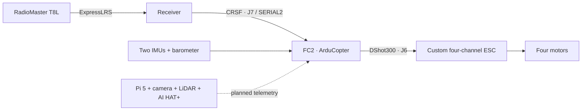

# Flight Controller V2 — engineering handover

This handover helps the incoming GAMUDA engineering team continue the FC2 drone prototype. It covers the flight controller, receiver, Mission Planner configuration and the FC interfaces to the custom ESC and planned Raspberry Pi perception system. Prepared by consolidating the outgoing contributor's records on **1 November 2026**.

**The project reached bench development, not flight qualification.** FC startup, receiver inputs, arming transitions and physical motor rotation were recorded; the outgoing contributor reported working stick controls. Motor order/direction acceptance, sensor consistency, battery monitoring, failsafes and Pi power remain unfinished. Start with inspection and reproduction of the saved state, not a firmware update or takeoff.

## Start here

1. [First-day walkthrough](START-HERE.md) — receive, identify and connect without propulsion.
2. [Current status](CURRENT-STATUS.md) — what worked, what remains open and the last saved settings.
3. [Safety and stopping conditions](SAFETY.md).
4. [Open issues and required evidence](handover/OPEN-ISSUES.md).
5. [Continuation gates](docs/14-continuation-plan.md) — assign owners and work through acceptance.



The diagram shows signal roles, not physical pin orientation or power wiring. Use the [connector and power tables](docs/03-wiring-and-power.md) and check the actual harness with power disconnected.

## Technical guides

| Read | Guide |
|---|---|
| Understand the system | [01 Foundations](docs/01-foundations.md) |
| Identify the article | [02 Hardware](docs/02-hardware-identification.md) |
| Verify each electrical interface | [03 Wiring and power](docs/03-wiring-and-power.md) |
| Connect and save a backup | [04 Mission Planner](docs/04-mission-planner.md) |
| Check orientation and calibration | [05 Sensors](docs/05-sensors-and-orientation.md) |
| Preserve the radio link | [06 Receiver and ExpressLRS](docs/06-receiver.md) |
| Check sticks, calibration and final arm control | [07 Controls](docs/07-controls-and-calibration.md) |
| Identify and test propulsion after gates pass | [08 ESC and motors](docs/08-esc-and-motors.md) |
| Diagnose companion power and commission sensors | [09 Pi, camera, LiDAR and AI HAT+](docs/09-pi-camera-lidar.md) |
| Establish telemetry before command authority | [10 FC–Pi MAVLink](docs/10-fc-pi-mavlink.md) |
| Plan navigation and battery sensing | [11 GPS, compass and monitoring](docs/11-gps-and-compass.md) |
| Distinguish builds and recover deliberately | [12 Firmware and recovery](docs/12-firmware-and-recovery.md) |
| Investigate faults | [13 Troubleshooting](docs/13-troubleshooting.md) |
| Plan the next engineering work | [14 Continuation and acceptance](docs/14-continuation-plan.md) |

## Files and transfer records

| Material | Location |
|---|---|
| Eleven unmodified device-specific exports and complete numerical comparisons | [Configuration](config/README.md) |
| Latest identified bench snapshot, 945 parameters | [21 October export](config/historical-fc2-snapshots/FC2_stick_control_working_2026-10-21.param) |
| Equipment and missing identifiers | [Equipment](handover/EQUIPMENT.md) |
| Incoming responsibilities | [Ownership](handover/OWNERSHIP.md) |
| Timeline and superseded steps | [Chronology](handover/CHRONOLOGY.md) |
| Blank test and transfer forms | [Acceptance](handover/ACCEPTANCE.md), [custody](handover/CUSTODY.md) |
| Sanitized recording catalog and evidence limits | [Evidence](evidence/README.md) |
| Original/public firmware distinction and hashes | [Firmware](firmware/README.md) |
| Already-public V2 source, drawings, manufacturing variants and neutral firmware | [Pinned reference snapshot](references/README.md) |
| Public scope, exclusions and license boundaries | [Publication record](handover/PUBLICATION-REVIEW.md), [notices](THIRD_PARTY_NOTICES.md) |
| Portable integrity and source checks | [Validation](inventory/VALIDATION.md), [verification instructions](inventory/README.md) |

## Which record takes precedence

The root status files and numbered guides describe the consolidated handover. The last identified configuration is from **21 October 2026**, not a fresh hardware read-back. Earlier shoulder-button arming instructions are superseded: the final file has `RC6_OPTION=0` and `ARMING_RUDDER=2`. Device-specific calibration is preserved as evidence, not a universal parameter template.

`references/v2-design/` is the public design tree pinned to [`56c91e283b9ce56b6e43480734feb60e2f078760`](https://github.com/desanv01/Flight-Controller-V2/tree/56c91e283b9ce56b6e43480734feb60e2f078760). Its archived development notes and historical validation statements are reference history. They do not override these continuation procedures or establish the actual received assembly. **The existing V2 repository is separate and was left untouched.** V1 is outside this handover's scope.

## Distribution and reproducibility

This repository is the authorized sanitized public edition. Raw recordings, desktop screenshots, private paths, credentials, supplier correspondence and original private engineering packages are excluded. Their engineering implications are summarized with explicit evidence limits. The full local evidence package remains with the project custodian; arrange its transfer privately.

Download its ZIP or use the clone command below to preserve exact bytes on Windows as well as Linux:

```sh
git clone -c core.autocrlf=false -c core.eol=lf https://github.com/desanv01/Flight-Controller-V2-Handover.git
cd Flight-Controller-V2-Handover
python tools/verify_handover.py
```

Use Python 3.10 or newer. Verification is read-only, uses the standard library, and does not connect to hardware or apply parameters. No Git LFS or private asset service is needed for included files. See [contributing](CONTRIBUTING.md) for recording future work.

No verified flight, autonomous navigation, obstacle avoidance, safe RTL, full-charge 6S ESC approval or combined Pi power qualification is claimed. A documentation check passing does not close a hardware issue.
